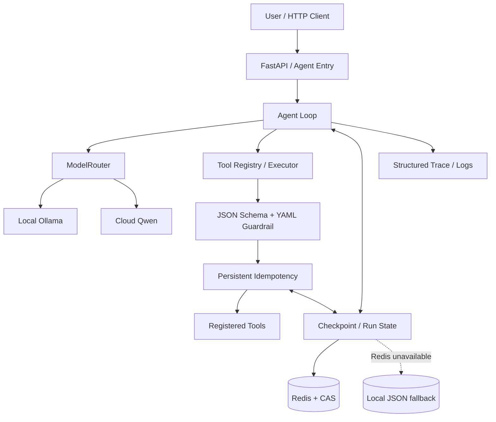

# Tiny Agent Harness

**A lightweight, recoverable Python Agent runtime — built to make tool execution observable, controllable, and safer to resume.**

一个从零实现的轻量级 Agent 运行框架。除了让大模型调用工具，项目更关注一个实际工程问题：**当模型超时、进程中断或存储短暂不可用时，如何恢复多步骤任务，并避免不确定的工具副作用被盲目重复执行？**

> **定位**：适合学习 Agent 执行机制、验证恢复/幂等设计的可运行参考实现。当前为 V1.0 原型，**不建议未经加固直接用于生产环境**。

## ✨ 核心特性

| 能力 | 实现重点 |
| --- | --- |
| **Agent Loop** | 多轮模型推理、工具调用、观察结果回传、最大步数控制 |
| **多模型路由** | 根据任务类型选择本地 Ollama 或 DashScope-compatible Qwen |
| **工具安全执行** | Tool Registry / Executor、JSON Schema 参数校验、YAML 护栏 |
| **Checkpoint 恢复** | Redis 持久化与 CAS 保护；Redis 不可用时使用本地 JSON 回退 |
| **持久化幂等** | 工具执行前原子预留调用记录；对已完成调用回放结果 |
| **不确定状态保护** | 对无法确认外部副作用的调用标记 `UNKNOWN`，等待人工核对，不自动重试 |
| **工程可观测性** | 超时、有限重试、指数退避、关联 `run_id` / `step` / `attempt` 的结构化日志 |
| **服务化与验证** | FastAPI 接口、离线端到端演示、Pytest 自动化测试 |

## 🧭 设计目标

许多 Agent 示例展示了「模型选择工具 → 执行工具 → 返回答案」。Tiny Agent Harness 进一步尝试回答：

- 进程在工具执行前后崩溃，**下次从哪里继续**？
- 重试时怎样**避免重复创建订单、重复发起外部操作**？
- 如果网络断开，无法判断工具是否已执行，系统**是否应该继续重试**？
- 当执行失败时，如何用日志和 Checkpoint **定位具体步骤**？

它不是 LangGraph 等成熟框架的替代品，而是把核心执行和恢复语义做得**相对小巧、透明、便于阅读与验证**。

## 🏗️ 架构概览



主要代码入口：

| 文件 | 作用 |
| --- | --- |
| [`core/loop.py`](core/loop.py) | Agent 执行循环与恢复控制 |
| [`router.py`](router.py) | 本地 / 云端模型路由与模型调用重试 |
| [`tools_pkg/executor.py`](tools_pkg/executor.py) | 工具执行、参数校验与护栏衔接 |
| [`core/idempotency.py`](core/idempotency.py) | 持久化幂等与工具调用状态管理 |
| [`core/memory.py`](core/memory.py) | 会话及 Checkpoint 存储 |
| [`core/trace.py`](core/trace.py) | 执行链路关联信息 |
| [`api.py`](api.py) | HTTP API |

## 🚀 快速运行

### 方案 A：先体验离线演示（推荐）

**要求：** Python 3.10+。以下示例使用 Windows PowerShell。

```powershell
git clone https://github.com/ice-818/tiny-agent-harness.git
cd tiny-agent-harness
python -m venv venv
.\venv\Scripts\Activate.ps1
python -m pip install -r requirements.txt

# 运行自动化测试
python -m pytest -q

# 运行离线端到端演示
python demo_e2e.py
```

`demo_e2e.py` 使用离线演示路径，不需要真实云端 API Key、Ollama 服务或 Redis 服务；它覆盖 HTTP API、Agent Loop、工具护栏、计算器工具与 Checkpoint 的主要流程。

### 方案 B：启动本地 API

先创建本地环境配置：

```powershell
Copy-Item .env.example .env
python -m uvicorn api:app --host 127.0.0.1 --port 8000
```

在浏览器中打开 **http://127.0.0.1:8000/docs** 查看 FastAPI 自动生成的交互式 API 文档。

如果要运行真实模型：本地聊天路由需要启动相应 Ollama 模型；云端推理路由需要在 `.env` 中设置自己的 `DASHSCOPE_API_KEY`。**不要提交 `.env` 或实际密钥。**

## 🔁 故障恢复与幂等：项目的关键设计

一次工具调用可能产生外部副作用，例如创建订单。不能把「请求没有收到响应」简单等同于「操作没有执行」。

因此，项目区分三类工具调用状态：

| 状态 | 恢复时的处理 | 是否自动重复执行工具 |
| --- | --- | --- |
| `COMPLETED` | 回放已保存的工具观察结果，继续 Agent Loop | **否** |
| `IN_PROGRESS` | 提示稍后重试，避免并发执行同一调用 | **否** |
| `UNKNOWN` | 将 run 标记为 `needs_manual_reconciliation`，等待人工核对外部系统 | **否** |

**为什么需要 `UNKNOWN`？** 假设创建订单请求已经发送出去，但网络在响应返回前断开。此时本地无法证明订单是否已创建；盲目重试可能造成重复订单。因此框架采取保守策略：**停止自动重试，等待人工核对业务状态**。

Redis 负责主要状态存储与 CAS 并发保护；当 Redis 不可用时，框架支持将恢复数据写入本地 JSON。**本地回退不等于跨机器高可用**，多实例协调仍需要合适的共享存储与部署设计。

## 🧪 测试与验证

```powershell
python -m pytest -q
python demo_e2e.py
```

项目 V1.0 开发时记录的测试结果为 **53 项测试通过**；请以当前克隆版本实际执行 `pytest` 的输出为准。

重点测试包括：模型路由、工具参数校验、权限拒绝、Agent Loop、重试、Checkpoint 恢复、幂等状态与 API 行为。相应测试位于 [`tests/`](tests/) 目录。

## 🔐 安全与适用边界

- YAML 护栏与 JSON Schema 校验可以约束已注册工具的输入和调用，但不能替代外部系统的权限管理。
- `UNKNOWN` 状态需要人工与外部业务系统核对；对于有副作用的生产工具，建议同时使用**外部业务幂等键**。
- V1.0 API **不内置身份认证、租户隔离、限流或后台任务队列**。不要直接把未加保护的 API 暴露在公网。
- 本地 JSON 回退更适合单机恢复场景；需要按业务要求配置备份、保留期限和数据保护。
- 公开仓库只保留 [`.env.example`](.env.example) 配置模板；真实密钥请置于本地环境变量或安全的密钥管理系统。

部署细节与限制参见 [`docs/deployment.md`](docs/deployment.md)。

## 📚 建议阅读顺序

1. [`tools_pkg/executor.py`](tools_pkg/executor.py)：了解工具如何被校验与执行。
2. [`core/loop.py`](core/loop.py)：理解模型调用、工具观察及 Checkpoint 的执行顺序。
3. [`core/idempotency.py`](core/idempotency.py)：理解 `COMPLETED`、`IN_PROGRESS`、`UNKNOWN` 状态语义。
4. [`demo_e2e.py`](demo_e2e.py) 与 [`tests/`](tests/)：通过演示和测试验证恢复行为。
5. [`api.py`](api.py)：了解如何通过 HTTP 启动、查看和恢复 run。

---

**项目目标：把 Agent 从「调用工具成功一次」推进到「在异常场景下仍能解释、恢复和安全停止」。**
